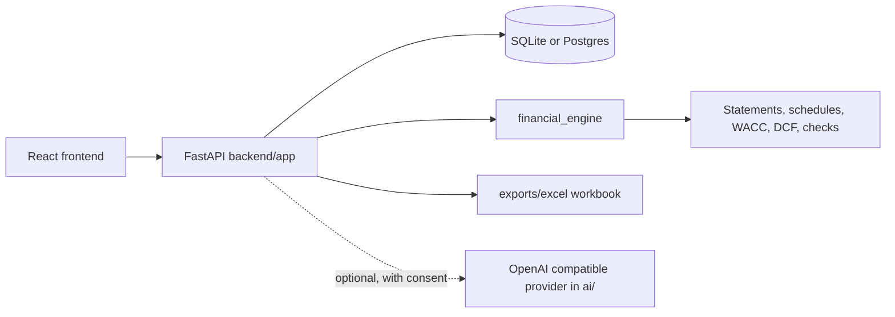

# ValuationLab

ValuationLab (this repository, `ai-in-validation-of-assets`) is a three statement forecasting and discounted cash flow (DCF) application for analysts and students who want every valuation figure to be traceable to a calculation. Historical figures, assumptions and market inputs are stored separately from valuation results. Every valuation number is produced by the Python calculation engine. The optional analyst quotes those results and does not calculate them.

Northline Industrial, loaded for the demo user, is a **synthetic** company. It is not a filing, a market price or a recommendation.

## How it works



The `financial_engine` package does all calculations with Python `Decimal`. Each change to an assumption creates a new model version and a new calculation run. The optional analyst in `ai/` only explains figures the engine has already produced.

## Run locally

Python 3.12 or newer and Node 22 are required.

```bash
python3.12 -m venv .venv
source .venv/bin/activate          # Windows: .venv\Scripts\activate
pip install -e ".[dev]"
python -m uvicorn backend.app.main:app --reload
```

In a second terminal:

```bash
cd frontend
npm ci
npm run dev
```

Open http://localhost:5173. Sign in with the demo account `demo` / `demo-valuationlab`.

The API is at http://127.0.0.1:8000. Interactive docs are at http://127.0.0.1:8000/docs. With no `DATABASE_URL`, the API uses `valuationlab.db` in the working directory. Set `DATABASE_URL` to a Postgres URL when you do not want SQLite. Copy `.env.example` for the other settings.

```bash
python -m pytest
```

## Docker

```bash
docker compose up --build
```

The web app is published on port 8080 and the API on port 8000. Compose uses Postgres. Change `VALUATIONLAB_SECRET` before any shared deployment.

## What the demo calculates

The seeded model projects Northline for 2025 to 2029 from the constructed 2022 to 2024 statements. Enterprise value, equity value and value per share are outputs of that run. Changing a growth rate creates a new model version and recalculates revenue, profit, working capital, cash flow and enterprise value. Historical 2024 revenue stays as entered.

Display scale in the header divides figures for reading. Stored amounts stay in absolute currency units.

## Verified run

Checked on 1 November 2026 on Linux with Python 3.12 and Node 20, using the default SQLite database.

| Check | Result |
| --- | --- |
| `pip install -e ".[dev]"` | ok |
| `python -m pytest` | 35 passed, 1 deprecation warning from Starlette's test client |
| `ruff check` (default rules) | 3 findings: an unused import, an unused variable, an f-string without placeholders |
| `npm ci && npm run build` (frontend) | ok, with Vite's chunk size warning |
| API: health, demo login, companies, DCF, checks | ok |
| Excel export (`POST /api/v1/models/{id}/export/excel`) | 200, 37 KB workbook |
| GitHub Actions | green (backend tests and frontend build) |
| Docker Compose | not run |

From the seeded Northline model (synthetic company, figures in USD, end of year discounting, Gordon growth terminal value):

| Output | Value |
| --- | --- |
| WACC | 8.59% |
| Terminal growth | 2.0% |
| PV of explicit cash flows, 2025 to 2029 | 33,945.62 |
| PV of terminal value | 108,073.40 |
| Enterprise value | 142,019.02 |
| Terminal share of EV | 76.1% |
| Equity value (after 20,000 debt and 6,000 excess cash) | 128,019.02 |
| Value per share (10,000 diluted shares) | 12.80 |
| Integrity checks | 120 of 120 pass |

The API also returns a warning that most of the value comes from the terminal value.

## Project structure

```text
financial_engine/   Decimal calculation engine: statements, schedules, WACC, DCF, sensitivities, checks
backend/app/        FastAPI routes, auth, storage and seed data
exports/excel/      Excel workbook builder and a formula evaluator used in tests
ai/                 optional explainer and OpenAI compatible provider
frontend/           React, TypeScript and Vite app
docs/               architecture, formulas, methodology and the Northline example
tests/              unit, integration and reference tests
```

Further reading: [architecture](docs/architecture/overview.md), [formulas](docs/financial-formulas/formulas.md), [conventions](docs/methodology/conventions.md), [Northline example](docs/examples/northline.md).

## Configuration

| Variable | Purpose | Default in `.env.example` |
| --- | --- | --- |
| `DATABASE_URL` | SQLite or Postgres URL | `sqlite:///./valuationlab.db` |
| `VALUATIONLAB_SECRET` | Signs login tokens. Change it before sharing | `dev-only-change-me` |
| `CORS_ORIGINS` | Allowed frontend origins | `http://localhost:5173,...` |
| `VALUATIONLAB_LLM_API_KEY` | Turns on the optional analyst | empty |
| `VALUATIONLAB_LLM_BASE_URL`, `VALUATIONLAB_LLM_MODEL` | Provider address and model | OpenAI defaults |

## Honest limits

- Market inputs are typed by the user. There is no live price feed.
- PDF text is not extracted. A PDF upload is stored as a source document and is not turned into statements.
- The Excel workbook's statements, WACC, DCF, WACC-versus-growth grid and WACC-versus-exit-multiple grid use formulas. Discount exponents follow the end-year or mid-year convention on the assumptions sheet. The selected terminal method drives enterprise value. Operating sensitivity tables are values calculated by the engine and are labelled on the sheet, because each cell is a full statement rebuild. The formula sheets match a growth-rate, percentage-cost, percentage-capex, opening-interest case. A different structure is named on the summary instead of being presented as the same formulas.
- OpenPyXL does not calculate workbooks. Formula checks use the Decimal interpreter in `exports/excel/evaluate.py`.
- Quarterly periods are not modelled. Annual periods can carry an explicit day count.
- The language-model provider is off unless `VALUATIONLAB_LLM_API_KEY` is set and the user consents. Consent sends a prepared brief of calculated figures, not uploaded files.
- The repository name says "ai in validation of assets", but the product is a DCF and forecasting tool where the language model is optional and off by default.
- The SQLite file `valuationlab.db` is created in whatever directory you start the API from.

## Status

Working demo on one synthetic company. Tests and the build pass in CI. It has not been checked against real company filings, and accuracy against professional valuation models has not been measured yet.

## Licence

No licence file is included, so all rights are reserved by default.

More of my work: https://cv.omnitest.dev/
